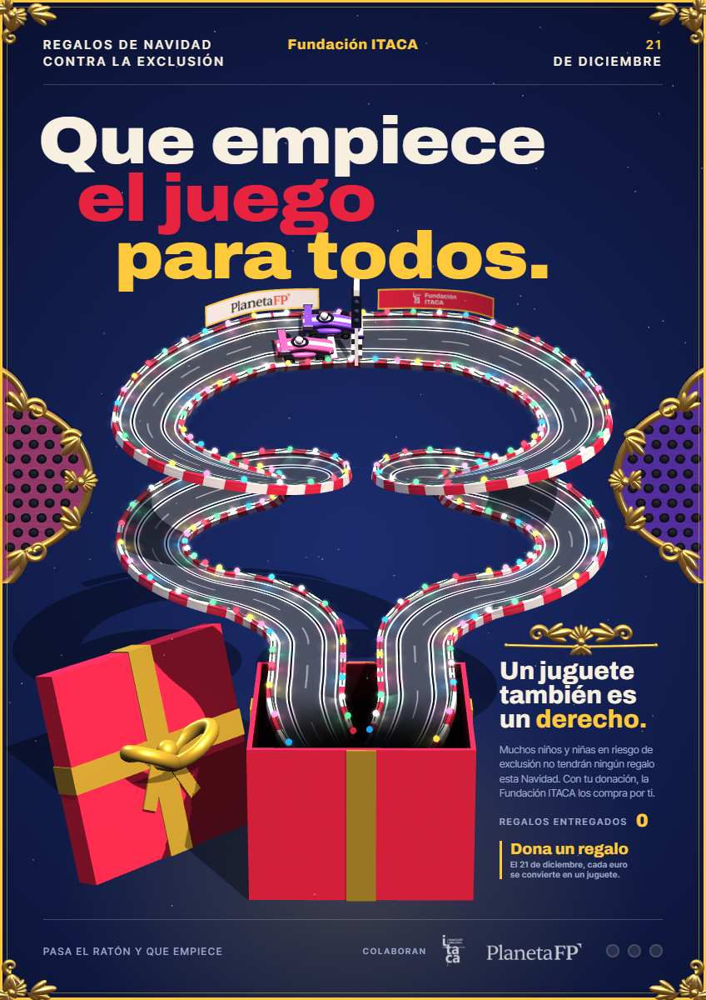

# Que empiece el juego para todos

Cartel digital interactivo para el **21 de diciembre · Fundación ITACA**, inspirado en *The Moving Poster*. Es una pieza de sensibilización que invita a **donar dinero para comprar regalos de Navidad a niños y niñas en riesgo de exclusión**.

Formato vertical de **848 × 1200 px** (A3 adaptado a pantalla). Si la ventana es más pequeña, el cartel se escala proporcionalmente sin deformar la composición.

## Concepto

Una caja de regalo abierta en la que **cada coche que entra es un regalo entregado**. De la caja sale un circuito de coches de juguete con un looping a cada lado. Arriba, en la salida, esperan dos coches, uno rosa y uno morado.

Cuando el cursor entra en el cartel, empieza el juego. El semáforo se pone en verde y los coches bajan por el circuito hasta meterse en la caja. Cada vez que entra uno, la caja salta, sale confeti y sube el contador **Regalos entregados**. Así el cartel convierte el gesto de jugar en el mensaje: que el juego empiece *para todos*, también para quien no tendrá regalos esta Navidad.

## Contenido del cartel

| Requisito | Dónde está |
| --- | --- |
| Fecha | Cabecera, a la derecha: **21 de diciembre**. |
| Tema | Cabecera: *Regalos de Navidad contra la exclusión* · **Fundación ITACA**. |
| Mensaje de sensibilización | Titular **«Que empiece el juego para todos.»** y, junto a la caja, **«Un juguete también es un derecho.»**: muchos niños y niñas en riesgo de exclusión no tendrán regalo y, con tu donación, la Fundación ITACA los compra. Cierra con **«Dona un regalo»**: el 21 de diciembre, cada euro se convierte en un juguete. |
| Composición visual | Caja de regalo, circuito de juguete con luces de Navidad y marco dorado (escena 3D con three.js). |
| Elementos que reaccionan | Coches y semáforo, cámara y capas de texto (paralaje), letras del titular, pedales de turbo, mensaje, contador y logos. |
| Branding | Fundación ITACA en la cabecera; logos de la Fundación ITACA y de PlanetaFP en el pie («Colaboran») y en las vallas de la pista. |

## Eventos de JavaScript

Todas las interacciones se programan con `addEventListener()` y funciones propias; no se usa `:hover` de CSS. Las transiciones de CSS solo suavizan los cambios que hace JavaScript.

### 1 · `mouseenter`

- **Cartel** (`handlePosterEnter`): da la salida. Se encienden tres luces rojas y luego la verde, en el pie y en el pórtico 3D, y los coches arrancan.
- **Pedales de turbo** (`handleBoostEnter`): el pedal del lateral se hunde en su marco y se ilumina, y el coche de su color acelera.
- **Letras del titular** (`handleLetterEnter`): cada letra salta, se ladea y cambia de color.
- **Mensaje** (`handleMessageEnter`): crece y la frase pasa a dorado.
- **Logos** (`handlePartnerEnter`): pasan de blanco a su color original y crecen.

### 2 · `mouseleave`

- **Cartel** (`handlePosterLeave`): si el semáforo aún no está en verde, la salida se cancela. Si ya corren, los coches terminan la vuelta y se quedan esperando en la salida. La cámara y las capas vuelven a su sitio.
- **Pedales, letras, mensaje y logos** (`handleBoostLeave`, `handleLetterLeave`, `handleMessageLeave`, `handlePartnerLeave`): recuperan su apariencia inicial con una transición. El pedal sube con un rebote y el coche frena poco a poco.

### 3 · `mousemove`

`handlePosterMove` convierte la posición del cursor a coordenadas del cartel (848 × 1200) y con ellas:

- la **cámara gira** alrededor de la caja;
- el titular, la cabecera, el pie y la escena se desplazan en direcciones opuestas, creando un efecto de **profundidad** (paralaje).

### Propiedades visuales que cambia JavaScript

- `transform`: paralaje, escala del cartel, letras, mensaje, logos y contador.
- `color`, `filter` y `opacity`: letras, mensaje y logos.
- `background` y `box-shadow`: luces del semáforo del pie.
- `textContent`: mensajes del pie («Preparados…», «¡Ya!», «¡Un regalo entregado!»…) y contador de regalos.
- En la escena 3D: posición de los coches, giro de las ruedas, estelas, rebote de la caja y de la tapa, confeti, luces y pedales.

## Cómo ejecutarlo

Abre `index.html` en el navegador con doble clic. No necesita servidor. Solo hace falta conexión para las tipografías de Google Fonts; sin ella, el cartel usa una tipografía del sistema.

Para hacer capturas sin ratón: `index.html?sim=4` simula 4 segundos con el cursor encima.

## Estructura

| Archivo | Contenido |
| --- | --- |
| `index.html` | Estructura del cartel en capas: escena 3D, marco, pedales, cabecera, titular, mensaje y pie. |
| `style.css` | Maquetación, tipografía (Archivo + Inter Tight) y paleta. |
| `main.js` | Escena three.js, ciclo de la carrera y todos los eventos. |
| `logos-data.js` | Los logos incrustados como data URI, para usarlos como textura 3D (ver abajo). |
| `Imgs/` | Logos de la Fundación ITACA y de PlanetaFP. |
| `lib/three.min.js` | three.js r128, en local. |
| `captura.png` | Captura del cartel completo. |

## Detalles técnicos

- **Circuito**: es una curva cerrada (`CatmullRomCurve3`) que empieza y acaba dentro de la caja. A lo largo de ella se calculan 1.500 marcos con peralte, y sobre ellos se generan el asfalto y los bordillos. Dentro de la caja, la pista y los coches se funden a negro.
- **Ciclo**: cada coche va a su ritmo. Baja, entra en la caja, sale tras una pausa corta y sube hasta la parrilla. La parrilla es el único sitio donde un coche espera al otro. Mientras el cursor siga encima, la carrera vuelve a empezar.
- **Turbo**: lleva al coche hasta un 75 % más rápido (`CONFIG.boostGain`). Sirve en la bajada, acorta la pausa dentro de la caja y acelera la subida.
- **Pedales y marco dorado**: cada pedal es una escena three.js en su propio `<canvas>`. Es una cartela barroca de oro (volutas de acanto y concha) con un pedal de aluminio y tacos de goma en el interior. Las esquinas del marco y la cresta del mensaje se dibujan una vez en 3D y se guardan como imagen.
- **Luces de Navidad y vallas**: las bombillas de los bordillos titilan e iluminan la pista. Las vallas de la salida llevan los logos de las entidades. Chrome no deja usar en WebGL imágenes cargadas desde disco, así que los logos de las vallas salen de `logos-data.js`.
- **Pantallas táctiles**: tocar el cartel da la salida, arrastrar el dedo mueve la cámara y mantener pulsado un pedal es el turbo.
- **Reducir movimiento**: con `prefers-reduced-motion` activado, desaparecen el paralaje, la nieve y casi todo el confeti.
