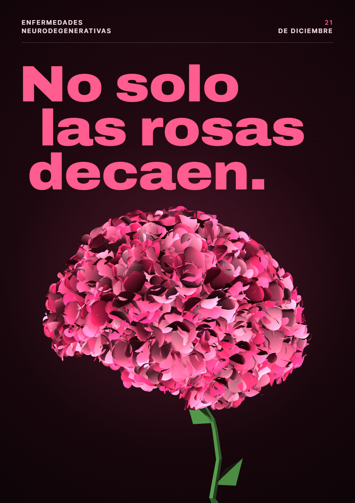

# No solo las rosas decaen

Cartel digital interactivo para el **21 de diciembre · Enfermedades neurodegenerativas**, inspirado en *The Moving Poster*.

Formato vertical de **848 × 1200 px** (A3 adaptado a pantalla). Si la ventana es más pequeña, se escala proporcionalmente sin deformar la composición.

## Concepto

Un cerebro en 3D formado por miles de pétalos rosas se sostiene sobre un tallo de papiroflexia (tramos rectos y hojas plegadas), como si fuera una rosa. Mientras el cursor permanece sobre el cartel, la flor se marchita: los pétalos se oscurecen y se desprenden, el tallo se seca y la "cabeza" se inclina. El titular **"No solo las rosas decaen"** se deshoja con ella: sus letras gruesas sueltan pétalos y se vuelven finas y frágiles. A la vez, el fondo se apaga hasta el negro, el cartel empieza a temblar levemente y en la oscuridad se abren ojos turbios que observan el cerebro, como la mirada impotente de quienes acompañan la enfermedad.

Las enfermedades neurodegenerativas (alzhéimer, párkinson, ELA…) actúan igual: apagan poco a poco la memoria, el movimiento y la identidad. Cuando el cerebro se marchita del todo, en su lugar se abre un **ojo** que mira fijamente a quien observa el cartel, alternando entre sus dos ojos. Dos segundos después, **la pantalla se rompe como un cristal** desde ese ojo: los cristales caen y, debajo, todo ha vuelto a florecer.

## Cómo ejecutarlo

Abre `index.html` en el navegador con doble clic. No necesita servidor ni conexión, salvo para cargar las tipografías de Google Fonts.

## Estructura

| Archivo | Contenido |
| --- | --- |
| `index.html` | Estructura del cartel en capas: fondo y ojos, escena 3D, ojo grande, titular, pétalos, cristales y cabecera. |
| `style.css` | Maquetación, tipografía sin serifa (Archivo variable + Inter Tight) y paleta. |
| `main.js` | Escena three.js, sistema de pétalos, ciclo de vida y eventos de ratón. |
| `brain-points.js` | Nube de puntos del cerebro (14.481 vértices), convertida del modelo `brain_vertex_low.obj` de [victors1681/3dbrain](https://github.com/victors1681/3dbrain). |
| `lib/three.min.js` | three.js r128. |

Los cristales de la pantalla rota usan un shader de *liquid glass* (bisel, refracción, aberración cromática y brillo especular) adaptado de [liquidGL](https://github.com/naughtyduk/liquidGL) (MIT © NaughtyDuk).

## Eventos de JavaScript

Todas las interacciones se registran con `addEventListener()`; no se usa `:hover` de CSS.

### 1 · `mouseenter`

- **Sobre el cartel** (`handlePosterEnter`): activa la decadencia. Cada segundo con el cursor dentro, el cerebro avanza hacia el marchitamiento, que se completa en unos 5 segundos.
- **Sobre cada letra del titular** (`handleLetterEnter`): la letra se eleva, crece (`transform`), brilla (`filter`) y suelta una ráfaga de pétalos.

### 2 · `mouseleave`

- **Del cartel** (`handlePosterLeave`): la decadencia se pausa y la flor se recupera un poco, pero nunca del todo: los pétalos que vuelven a crecer no compensan lo perdido. El cerebro y las capas vuelven a su posición inicial.
- **De cada letra** (`handleLetterLeave`): la letra recupera su tamaño, posición y brillo iniciales mediante una transición.

### 3 · `mousemove`

`handlePosterMove` guarda las coordenadas del cursor (convertidas al sistema 848 × 1200 del cartel) y con ellas:

- el **cerebro gira** hacia el cursor;
- las capas se desplazan en direcciones opuestas creando un efecto de **paralaje** y profundidad;
- las **letras más cercanas al cursor se deshojan antes** que el resto.

## Propiedades visuales modificadas desde JavaScript

- `font-variation-settings`: el grosor de cada letra (`wght` 900 → 100) y su anchura (`wdth` 112 → 82).
- `color` y `opacity`: de rosa intenso a malva marchito.
- `transform`: caída e inclinación de las letras, hover de cada letra y paralaje de las capas.
- `filter`: brillo de la letra al pasar el ratón.
- En la escena 3D: escala, posición y color de cada pétalo; color y longitud del tallo; inclinación del cerebro.
- Fondo: `opacity` de la capa negra y `transform` del cartel para el temblor. Los ojos se dibujan en un `<canvas>`: se abren, tiemblan, dan tirones, parpadean, se duplican como en una visión doble y orientan el iris hacia la posición del cerebro en pantalla. Cada pocos segundos todos miran a la vez al cursor (usando las coordenadas de `mousemove`), es decir, al espectador.

## Ciclo

1. **Florecido**: cerebro rosa y letras gruesas.
2. **Decadencia** (solo con el cursor encima): los pétalos se marchitan y caen a cachos; las letras adelgazan.
3. **Marchito**: solo queda el "esqueleto" del cerebro, una nube de puntos tenue, rodeado de ojos sobre fondo negro.
4. **La mirada** (2 s): donde estaba el cerebro se abre un ojo grande que mira al frente, alternando de izquierda a derecha como si mirara a los ojos del espectador, con la pupila temblando. Los ojos del fondo también miran al frente.
5. **Cristal roto** (automático): la imagen se agrieta desde el ojo y los cristales caen girando; debajo, el cerebro vuelve a estar rosa, las letras gruesas y el fondo granate.
6. Vuelta al estado 1.

Como alternativa, en `CONFIG` de `main.js` se puede poner `returnTransition: 'regrow'` para que, en vez de romperse el cristal, el cerebro vuelva a brotar desde el tallo como una planta.
